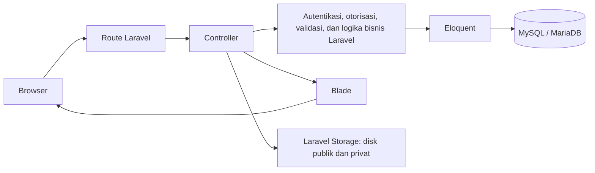
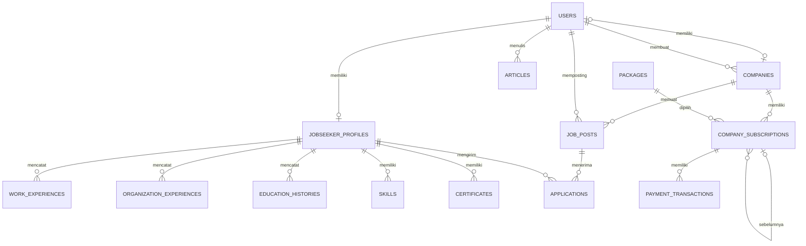

# Arsitektur Start Work Website

## 1. Tujuan dan Cakupan

Start Work adalah platform lowongan kerja yang mempertemukan Jobseeker dengan Employer. Sistem merupakan migrasi web native dari Squarespace dengan tiga role: Jobseeker, Employer, dan Admin Internal. Dokumen ini merangkum arsitektur berdasarkan PRD_StartWork.md dan skema Database.md.

Cakupan sistem meliputi halaman publik, akun Jobseeker, dashboard Employer, panel CMS Admin Internal, lowongan dan lamaran, artikel, package, langganan, serta transaksi pembayaran.

## 2. Arsitektur Sistem

Start Work direncanakan sebagai satu aplikasi Laravel berbasis PHP dengan Blade untuk merender halaman di server. Aplikasi monolitik ini tidak menggunakan API terpisah. Alur permintaan: Browser → route Laravel → controller → Eloquent → MySQL/MariaDB. Laravel mengembalikan respons berupa halaman Blade.

| Bagian | Teknologi atau tanggung jawab |
| --- | --- |
| Aplikasi web | Laravel (PHP), satu codebase monolitik |
| Routing dan logika | Route dan controller Laravel; logika bisnis mencakup autentikasi, role, validasi, lamaran, kuota, dan posting loker |
| Tampilan | Blade server-side untuk halaman publik, Jobseeker, Employer, dan Admin Internal; layout dan komponen digunakan ulang |
| Persistensi | MySQL/MariaDB melalui Eloquent dan migration Laravel |
| File | Laravel Storage, dengan disk publik dan privat |
| Pengembangan | Laragon pada Windows, berisi web server, PHP, MySQL, Composer, dan Node.js |

Supabase dan React tidak digunakan pada rencana ini. Laragon adalah lingkungan pengembangan lokal; hosting produksi belum diputuskan.

## 3. Lapisan dan Tanggung Jawab Aplikasi

### 3.1 Route, Controller, dan Tampilan

Route Laravel menerima permintaan halaman dan aksi pengguna. Controller menjalankan validasi, memeriksa akses, memanggil model Eloquent untuk operasi data, dan mengembalikan tampilan Blade. Halaman dirender di server; tidak ada API terpisah.

Blade menyediakan layout publik, dashboard Employer, dan panel Admin, serta komponen yang dapat digunakan ulang. Alpine.js direncanakan untuk interaksi antarmuka; Livewire dapat dipertimbangkan untuk form atau filter yang sangat dinamis. Interaksi yang disebutkan mencakup dropdown pencarian, tab, stepper, date picker, dan entri data berulang.

### 3.2 Autentikasi dan Otorisasi

Autentikasi menggunakan sesi Laravel Auth, Laravel Breeze stack Blade, dan Laravel Socialite untuk login Google. Sistem menyediakan registrasi, login, reset kata sandi, dan verifikasi email sesuai scaffolding yang direncanakan.

Role adalah `jobseeker`, `employer`, dan `admin`. Middleware role, Gate, dan Policy Laravel membatasi akses berdasarkan role serta kepemilikan data. Spatie Laravel-Permission hanya menjadi opsi jika jumlah role bertambah banyak.

| Akses | Batasan |
| --- | --- |
| Jobseeker | Mengelola profil dan melihat lamaran miliknya sendiri |
| Employer | Mengelola perusahaan dan loker miliknya; melihat pelamar pada loker miliknya |
| Admin Internal | Mengelola package/langganan, memonitor perusahaan, lowongan dan pelamar, memposting atas nama perusahaan, mengelola artikel, serta melihat data diri/CV sesuai hak akses |
| CV Jobseeker | Diakses pemilik akun, Employer untuk pelamar pada loker miliknya, dan Admin Internal sesuai hak akses. Unduhan melalui controller yang memeriksa Policy, bukan URL publik |

Validasi server menggunakan Form Request Laravel. Atribut HTML dapat memberi umpan balik cepat, tetapi validasi server tetap menjadi acuan.

### 3.3 Akses Data dan Skema

Model Eloquent menangani relasi User, JobseekerProfile, Company, JobPost, Application, Article, Package, CompanySubscription, dan PaymentTransaction. Skema dikelola dengan migration Laravel agar perubahan database tercatat di repository. Tabel dan relasi dirangkum pada Bagian 5.

## 4. Area Fungsional

| Area | Fungsi utama |
| --- | --- |
| Halaman publik | Landing, Loker, Perusahaan, About Us, FAQs, dan Blog; browsing dapat dilakukan tanpa login |
| Jobseeker | Registrasi/login, profil, unggah foto dan CV, pencarian lowongan, apply, dan Lamaran Saya |
| Employer | Registrasi/login, Company Setup, dashboard, pengelolaan perusahaan dan loker, package/langganan, serta daftar pelamar dan CV untuk loker miliknya |
| Admin Internal | CMS untuk Kelola Loker, package/langganan, perusahaan, lowongan, pelamar, posting atas nama perusahaan, dan artikel/news |

## 5. Arsitektur Data

Entitas utama menggunakan UUID sebagai primary key sesuai Database.md. Relasi utama:

### 5.1 Akun dan Profil Jobseeker

| Tabel | Isi dan relasi |
| --- | --- |
| `users` | Akun: nama lengkap, telepon, email unik, verifikasi email, hash kata sandi, posisi, lokasi, role, waktu pembuatan. Telepon boleh kosong untuk akun Google; hash kata sandi boleh kosong untuk akun yang hanya dibuat lewat Google. |
| `jobseeker_profiles` | Profil Jobseeker terkait satu user melalui `user_id` unik; memuat foto, nama, domisili, tanggal lahir, gender, pendidikan terakhir, link portofolio, referensi CV, nama file, dan waktu unggah CV. |
| `work_experiences` | Riwayat kerja/magang terkait profil: jabatan, perusahaan, tanggal, tanggung jawab utama. |
| `organization_experiences` | Riwayat organisasi terkait profil: nama organisasi, peran, tanggal, deskripsi. |
| `education_histories` | Riwayat pendidikan terkait profil: jenjang, institusi, jurusan, tanggal. |
| `skills` | Daftar keahlian terkait profil. |
| `certificates` | Sertifikat terkait profil, dengan nama dan referensi file opsional. |

Satu JobseekerProfile memiliki banyak WorkExperience, OrganizationExperience, EducationHistory, Skill, Certificate, dan Application.

### 5.2 Perusahaan, Lowongan, dan Lamaran

| Tabel | Isi dan relasi |
| --- | --- |
| `companies` | Perusahaan: pemilik Employer opsional, user pembuat opsional, nama, lokasi, logo, website, URL kontak, deskripsi, dan waktu pembuatan. `owner_user_id` unik dan dapat kosong; `created_by` dapat merujuk Employer atau Admin yang membuat data. |
| `job_posts` | Lowongan terkait perusahaan dan user yang memposting; `subscription_id` opsional menunjuk subscription yang kuotanya dipakai. Memuat judul, kategori, lokasi, tipe pekerjaan, sistem kerja, rentang gaji opsional, deskripsi, tanggung jawab, persyaratan, skills, benefit, status, masa tayang, dan waktu pembuatan. |
| `applications` | Menghubungkan satu lowongan dengan satu profil Jobseeker; memuat waktu apply, status, dan referensi atau salinan CV. Kombinasi `job_posts_id` dan `profile_id` unik untuk mencegah lamaran ganda. |

Indeks `job_posts`: `(company_id, status)` dan `(status, expires_at)`. Loker Admin dapat memiliki `subscription_id` kosong karena tidak memakai kuota.

### 5.3 Artikel

Tabel `articles` menyimpan penulis (`author_id` ke `users`), judul, gambar cover opsional, isi, status draft/published, dan waktu publikasi. Artikel published ditampilkan pada Blog.

### 5.4 Package, Langganan, dan Pembayaran

| Tabel | Isi dan relasi |
| --- | --- |
| `packages` | Katalog dengan nama unik, kuota, durasi hari, harga, mata uang (default IDR), dan status aktif. Harga yang ditentukan: Basic Rp 99.000, Standard Rp 149.000, Premium Rp 239.000. |
| `company_subscriptions` | Langganan perusahaan ke package: subscription sebelumnya opsional, sumber, jenis perubahan, status, salinan kuota, kuota terpakai, snapshot harga, periode, dan Admin pemberi trial bila ada. Indeks `(company_id, status)`. |
| `payment_transactions` | Transaksi subscription: referensi refund opsional ke transaksi asal, jenis, nominal dibayar, kredit upgrade, mata uang, status, provider/referensi provider, batas waktu pembayaran, waktu pembayaran, dan waktu pembuatan. `provider_reference` unik jika diisi. |

Sumber subscription adalah `purchase` atau `admin_trial`; jenis perubahan adalah `new`, `renewal`, `upgrade`, `downgrade`, atau `trial`. Snapshot kuota dan harga menyimpan nilai saat subscription dibuat; trial Admin memiliki snapshot harga 0. `credit_applied` adalah kredit upgrade, bukan nominal yang dibayar ke gateway.

## 6. Siklus Data dan Aturan Bisnis

### 6.1 Pencarian Lowongan

Pengguna mengirim kata kunci atau filter ke halaman Loker. Sistem mengambil lowongan yang sesuai dari database dan merender hasil melalui Blade. Filter: Category, Job Type, Work Type, Date Posted. Sort: Latest, Oldest, A-Z, Z-A. Query scope Eloquent dan paginator bawaan digunakan untuk filter, sort, dan pagination. Card lowongan di landing dapat membuka Job Detail secara langsung.

### 6.2 Apply Lowongan

Saat Jobseeker memilih Apply, sistem memeriksa sesi login, kelengkapan profil dan CV, serta apakah lamaran untuk lowongan yang sama sudah ada. Jika belum login, pengguna diarahkan ke login lalu kembali ke Job Detail. Jika profil belum lengkap, pengguna diarahkan untuk melengkapinya. Lamaran valid disimpan dengan lowongan, profil, waktu apply, status, dan referensi atau salinan CV. Lamaran muncul di Lamaran Saya dan daftar pelamar Employer. Constraint unik pada pasangan lowongan dan profil mencegah lamaran ganda.

### 6.3 Posting Lowongan Employer

Employer mengelola loker melalui dashboard. Loker hanya dapat dipublikasikan bila perusahaan memiliki package berbayar yang aktif dan kuota tersisa. Setiap loker yang berhasil diposting memakai satu kuota; `job_posts.subscription_id` mencatat subscription yang digunakan.

### 6.4 Posting Lowongan Admin

Admin memilih perusahaan terdaftar atau memasukkan perusahaan baru, lalu mengisi form Post Job. Lowongan terkait ke perusahaan dan user Admin yang memposting. Loker Admin dapat tidak memakai kuota dan tampil di halaman Loker publik.

### 6.5 Langganan dan Trial

Employer memilih package dan pembayaran harus terkonfirmasi sebelum package aktif. Langganan kedaluwarsa tidak dapat digunakan untuk posting baru. Admin dapat memberi trial 7 hari kepada perusahaan yang belum berlangganan menggunakan kuota package yang dipilih. Subscription menyimpan status, kuota total/terpakai, snapshot harga, periode, sumber, jenis perubahan, dan relasi subscription sebelumnya bila ada.

### 6.6 Artikel

Admin mengisi judul, foto, dan isi artikel, lalu menyimpannya sebagai draft atau mempublikasikannya. Artikel published tampil sebagai card pada Blog dan dapat dibuka Jobseeker.

## 7. File dan Data Pribadi

File dikelola melalui Laravel Storage. CV, foto profil, dan sertifikat disimpan pada disk privat karena memuat data pribadi. Logo perusahaan dan foto artikel disimpan pada disk publik. Akses CV melewati controller yang memeriksa Policy. Validasi upload: foto profil JPG/JPEG/PNG maksimal 2 MB; CV PNG/JPEG/PDF maksimal 5 MB.

## 8. Status Data

| Enum | Nilai |
| --- | --- |
| `user_role` | `jobseeker`, `employer`, `admin` |
| `job_post_status` | `active`, `inactive`, `expired` |
| `application_status` | `submitted`, `viewed`, `in_process`, `accepted`, `rejected`, `withdrawn` |
| `article_status` | `draft`, `published` |
| `subscription_status` | `pending`, `scheduled`, `active`, `expired`, `cancelled`, `replaced` |
| `subscription_source` | `purchase`, `admin_trial` |
| `subscription_change_type` | `new`, `renewal`, `upgrade`, `downgrade`, `trial` |
| `payment_status` | `pending`, `paid`, `failed`, `expired`, `refunded` |
| `payment_type` | `purchase`, `upgrade`, `renewal`, `refund` |

## 9. Lingkungan dan Keputusan yang Belum Ditentukan

Lingkungan pengembangan adalah Laragon pada Windows dengan MySQL/MariaDB. Versi PHP dan MySQL produksi perlu disamakan dengan lingkungan pengembangan. Hosting produksi dan staging belum diputuskan.

Keputusan yang belum ditetapkan dalam dokumen sumber:

- Gateway atau metode pembayaran package.
- Hosting produksi dan konfigurasi staging.
- Editor rich text untuk artikel.
- Pilihan akhir Alpine.js atau Livewire untuk bagian interaktif tertentu; Livewire adalah opsi.
- Implementasi panel Admin: Blade atau Filament berbasis Livewire. Filament dapat mempercepat CMS dengan konsekuensi tampilan panel berbeda.
- Bentuk penyimpanan UUID pada MySQL (`char(36)` atau `binary`) atau penggantian dengan auto-increment sesuai keputusan tim.

## 10. Library Pendukung yang Disarankan

| Kebutuhan | Saran dalam dokumen sumber |
| --- | --- |
| Autentikasi | Laravel Breeze stack Blade |
| Login Google | Laravel Socialite |
| Otorisasi | Gate dan Policy Laravel; Spatie Laravel-Permission jika role bertambah banyak |
| Validasi | Form Request Laravel |
| Interaktivitas | Alpine.js; Livewire untuk form/filter sangat dinamis |
| Styling | Tailwind CSS melalui Vite atau Bootstrap |
| Date picker dan dropdown pencarian | Flatpickr dan Tom Select atau Choices.js |
| Upload/pengolahan gambar | Laravel Storage; Intervention Image opsional untuk mengecilkan foto |
| Filter, sort, pagination | Query scope Eloquent dan paginator bawaan |
| Notifikasi pelamar baru | Laravel Notification/Mail dengan Queue driver database, jika notifikasi diputuskan |
| SEO | Meta tag per halaman Blade; paket sitemap seperti spatie/laravel-sitemap |
| Audit log Admin | Paket seperti spatie/laravel-activitylog |
| Pembayaran | SDK gateway yang dipilih; gateway belum ditentukan |
